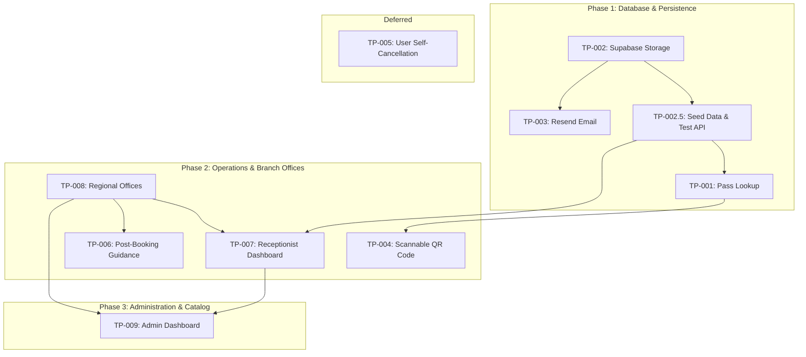

# 🎫 TourPortal — Ticket Tracker

> Central progress dashboard for TourPortal development milestones, features, and operational requirements.

---

## 📊 Summary Board

| Total Tickets | 🟢 Ready / Up Next | 🟡 In Progress | ⏸️ Deferred | ✅ Completed |
|:---:|:---:|:---:|:---:|:---:|
| **10** | **3** | **0** | **1** | **6 (TP-002, TP-002.5 + Specs)** |

---

## 📋 Master Ticket List

| Ticket ID | Title | Priority | Type | Status | Dependencies | Target Route / Area |
|---|---|---|---|---|---|---|
| [**TP-001**](./TP-001-pass-retrieval.md) | Pass retrieval page via reference & email | 🔴 High | Bug / Feature | 🟢 Ready | TP-002, TP-003 | `/booking/lookup` |
| [**TP-002**](./TP-002-persistent-booking-storage.md) | Persistent Supabase booking storage | 🔴 High | Infrastructure | ✅ **Completed** | *Supabase Client & RLS Active* | `Services/`, `Models/` |
| [**TP-002.5**](./TP-002.5-seed-data.md) | Seed initial data & test API connection | 🔴 High | Data / Testing | ✅ **Completed** | `database/seed.sql` | Supabase / `database/` |
| [**TP-003**](./TP-003-confirmation-email.md) | Confirmation email dispatch via Resend | 🔴 High | Feature | 🟢 Ready | TP-002 | `Services/Email` |
| [**TP-004**](./TP-004-qr-code-placeholder.md) | Dynamic scannable QR code generation | 🟡 Medium | Bug / Feature | ⚪ Backlog | TP-001 | `/booking/pass` |
| [**TP-005**](./TP-005-cancellation-flow.md) | Cancellation & modification flow | 🟢 Low | Feature | ⏸️ **Deferred** | TP-007 | *Manual via Desk* |
| [**TP-006**](./TP-006-post-booking-guidance.md) | Post-booking arrival guidance & office notice | 🟢 Low | UX / Copy | ⚪ Backlog | TP-008 | `/booking/pass` |
| [**TP-007**](./TP-007-receptionist-dashboard.md) | Receptionist check-in dashboard (Station PIN) | 🔴 High | Feature | 🟢 Ready | TP-002, TP-008 | `/reception` |
| [**TP-008**](./TP-008-office-location.md) | Regional offices & meetup points | 🟡 Medium | Data Model | ⚪ Backlog | — | `Models/Tour.cs` |
| [**TP-009**](./TP-009-admin-dashboard.md) | Admin dashboard & catalog CRUD (Master Passcode) | 🟡 Medium | Feature | ⚪ Backlog | TP-002, TP-008 | `/admin` |

---

## 🗺️ Execution Roadmap

---

## 🎯 Implementation Phases

### **Phase 1: Persistence & Verification Loop (In Progress)**
1. `TP-002`: Wire Supabase client with `database/schema.sql`.
2. `TP-002.5`: Run `database/seed.sql` and verify API with test queries.
3. `TP-001`: Create `/booking/lookup` page so users can recover passes across sessions.
4. `TP-003`: Send confirmation email via Resend containing the lookup link.

### **Phase 2: Ground Operations & Regional Offices**
1. `TP-008`: Add `TourOffice` to `Tour.cs` with regional seed data (Bali, Kyoto, Dolomites).
2. `TP-007`: Build `/reception` with 4-digit Station PIN unlock and office-scoped tours/check-in.
3. `TP-004`: Replace placeholder SVG with a real QR code pointing to `/booking/lookup?ref=...`.
4. `TP-006`: Add office arrival instructions to the pass page.

### **Phase 3: Catalog Management**
1. `TP-009`: Build `/admin` with Master Passcode gate for tour and departure slot CRUD.

---

## 🕒 Recent Activity Log

| Date | Milestone / Ticket | Summary |
|---|---|---|
| **2026-11-19** | `TP-002` | Persistent Supabase booking storage wired via `BookingStateService.cs`, `Booking.cs` model, and `database/schema.sql` with RLS. |
| **2026-11-19** | `TP-002.5` | Initial data seeded via `database/seed.sql`; verified REST API connectivity and test queries in `test.http`. |
| **2026-11-19** | Catalog Live Data | Connected `Home.razor` and `TourDetails.razor` to load active tours dynamically from Supabase database via `TourDataService.cs`. |
| **2026-11-19** | Server Stability | Eliminated sync-over-async deadlock in `TourDataService` and configured development HTTP redirection in `Program.cs`. |
